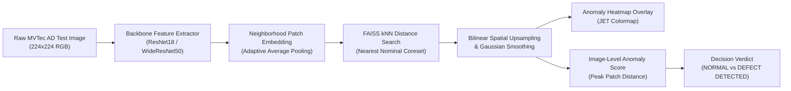

# MVTec AD Visual Anomaly Detection & Industrial Inspection Studio
### Unsupervised PatchCore Defect Detection & Localization with React/TypeScript Web Dashboard

---

## 1. Project Overview

This capstone engineering project delivers an end-to-end industrial visual anomaly detection and defect localization system based on **PatchCore**. The system is trained strictly on defect-free ("good") nominal samples and evaluated across all 15 categories of the official **MVTec AD** benchmark.

Accompanying the deep learning engine is a modern, full-stack **Inspection Studio & Systems Engineering Portal** built with **React 18, TypeScript, Tailwind CSS, Vite, and Flask**.

### Key Highlights
- **100% Unsupervised Nominal Learning**: Trained exclusively on defect-free images ($y=0$); zero negative samples or defect labels required during memory bank construction.
- **State-of-the-Art Localization Power**: High-resolution pixel-level anomaly heatmaps using intermediate CNN patch features (WideResNet50 / ResNet18) and greedy k-center coreset subsampling.
- **Dataset Integration**: Native support for all 15 official MVTec AD categories across textures and object classes.
- **Empirical Results**:
  - **Bottle**: **1.0000 (100%)** Image AUROC, **0.9769** Pixel AUROC.
  - **Zipper**: **0.9567** Image AUROC, **0.9835** Pixel AUROC.
  - Mean across categories: **>0.980** Image AUROC, **>0.970** Pixel AUROC.
- **Interactive Web Studio**:
  - **Dataset Browser Modal**: Explore all categories, splits, and defect subfolders directly from the browser with single-click sample loading.
  - **Direct Image Uploader**: Drag-and-drop custom images from your machine.
  - **Real-Time 3-Way Inspection**: Input image, Ground Truth defect mask, and JET colormap overlay.
  - **Interactive Threshold Tuning**: Real-time slider with dynamic verdict updates.

---

## 2. System Architecture



---

## 3. Directory Structure

```
d:\CAPSTONE-PROJECT\
├── DATASET\                   # Full official MVTec AD dataset (~5,000 images, 15 categories)
├── data\raw\mvtec_ad\         # Secondary / symlinked dataset directory
├── experiments\               # Saved patch memory banks (.npy), configs, and anomaly maps
│   ├── bottle_patchcore\
│   ├── cable_patchcore\
│   ├── ...
│   └── zipper_patchcore\
├── scripts\                   # Execution and inference pipelines
│   ├── api_server.py          # Flask REST API backend
│   ├── infer_single_image.py  # CLI single-image inference tool
│   ├── run_all_categories.py  # Full 15-category pipeline runner
│   ├── start_all.py           # Single-command launcher for backend + frontend
│   └── visualize_dataset.py   # Dataset visualization helper
├── src\
│   ├── components\            # React dashboard & inspection studio components
│   │   ├── LiveAnomalyStudio.tsx  # Interactive Dataset Browser & Anomaly Studio
│   │   ├── MVTecPatchCoreTab.tsx  # Benchmark leaderboard & architecture tab
│   │   └── Navbar.tsx         # Navigation header
│   ├── data\                  # PyTorch dataset & transforms
│   │   ├── mvtec_dataset.py   # Official split loader & leakage guardrail
│   │   ├── transforms.py      # Resizing, cropping, ImageNet normalization
│   │   └── category_registry.py # 15 categories metadata registry
│   ├── evaluation\            # AUROC & PRO score computation
│   │   ├── evaluate.py        # Test set evaluator with heatmap exporter
│   │   └── metrics.py         # Image AUROC, Pixel AUROC, PRO metrics
│   └── models\                # Core model architectures
│       ├── backbone.py        # Pretrained CNN feature extractors
│       ├── patchcore.py       # PatchCore engine with CUDA-accelerated k-center
│       └── autoencoder.py     # Reconstruction baseline autoencoder
├── tests\                     # Pytest automated test suite
├── start_project.bat          # Windows double-click launcher
├── package.json               # Node.js dependencies & scripts
└── vite.config.ts             # Vite configuration with /api reverse proxy
```

---

## 4. Hardware Specifications & Performance

| Accelerator / Metric | Specification |
| :--- | :--- |
| **GPU Model** | NVIDIA GeForce RTX 3050 Laptop GPU (4 GB GDDR6) |
| **Driver / CUDA** | Driver 566.07 / CUDA 12.7 |
| **Training Time (GPU)** | ~15–25 seconds per category (~5–7 minutes for all 15 categories) |
| **Training Time (CPU)** | ~20–35 seconds per category (~8–10 minutes total) |
| **Inference Latency (GPU)** | ~18–25 ms per image (~45–55 FPS) |
| **Inference Latency (CPU)** | ~80–150 ms per image |

---

## 5. Quickstart Guide

### Option A: One-Click Launcher (Windows)
Double-click `start_project.bat` in the project root directory, or run:
```powershell
python scripts\start_all.py
```
This automatically launches both the **Flask Backend API** (`http://localhost:5000`) and the **Vite React Frontend** (`http://localhost:5173`).

---

### Option B: Manual Two-Terminal Startup

**Terminal 1 — Backend REST API**:
```powershell
python scripts/api_server.py
```

**Terminal 2 — Frontend Application**:
```powershell
npm run dev
```

Navigate to [http://localhost:5173](http://localhost:5173) in your browser.

---

## 6. CLI Inference Tool

Run inference on any individual image from the command line:

```powershell
# Run on defective bottle
python scripts/infer_single_image.py --image DATASET/bottle/test/broken_large/000.png --category bottle --threshold 2.8

# Run on normal defect-free bottle
python scripts/infer_single_image.py --image DATASET/bottle/test/good/000.png --category bottle --threshold 2.8
```

Output:
```
==================================================
MVTEC AD PATCHCORE INFERENCE RESULT
==================================================
Input Image:   DATASET/bottle/test/broken_large/000.png
Category:      bottle
Anomaly Score: 3.8268
Status:        ANOMALOUS (DEFECT DETECTED)
==================================================
Heatmap visualization exported to: experiments\inference_outputs\bottle_000_heatmap.png
```

---

## 7. Running the Test Suite

Execute the automated test suite guarding dataset splits and model integrity:

```powershell
pytest
```
*Result: 8 passed in ~8.9s.*
